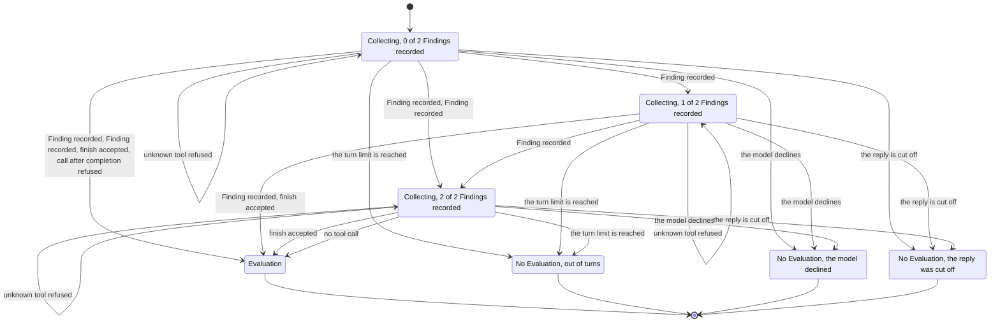

# The evaluation loop

<!-- Generated from runs of the real loop. Do not edit: run
     cd apps/call-qa-agent && uv run python -m tests.bounded.statechart -->

What `agent.evaluate` did over 2,380 scripted runs: every sequence of up to
3 turns over 13 kinds of turn, for a Scorecard of 2 Criteria. A state or an arrow
that needs a longer run or another kind of turn is not drawn.

Each arrow is one turn, labelled with what its tool results showed. The runs took
46 different turns. Where several lead from one state to another, the 29 with the
fewest tool results are drawn.

