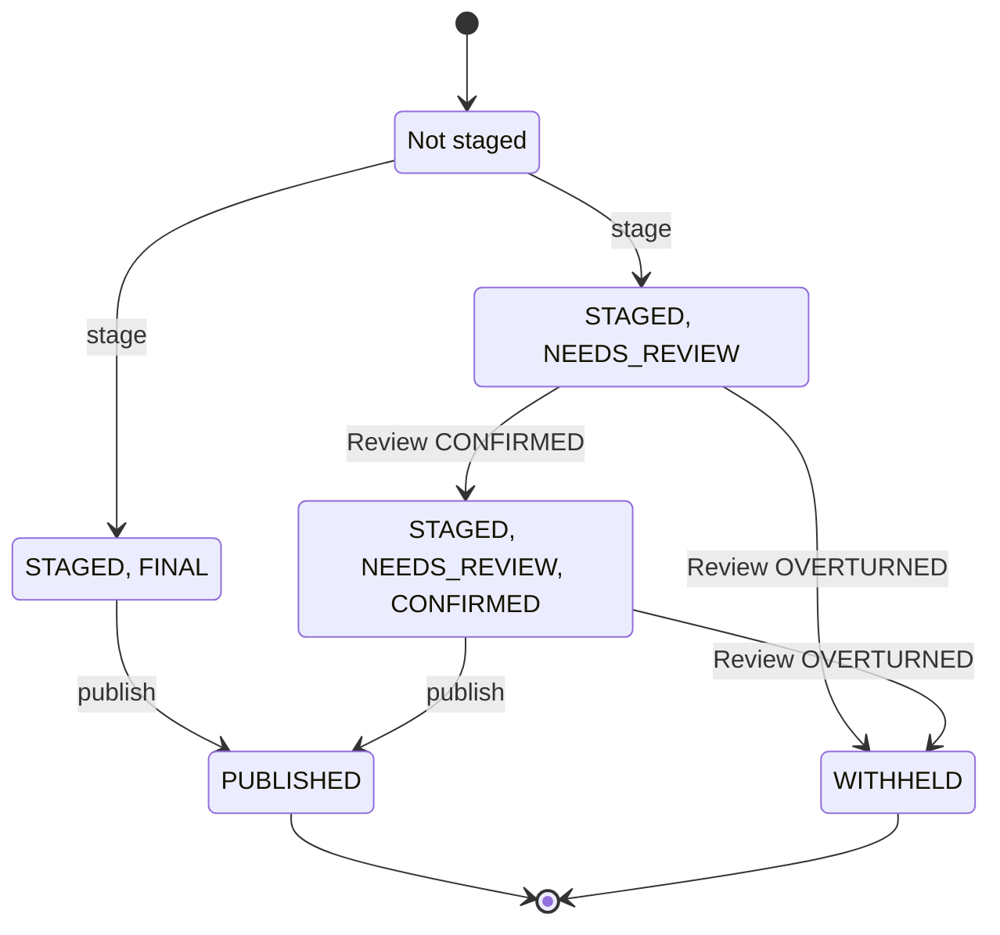

# The publication of an Evaluation

<!-- Generated from runs of the real ledger. Do not edit: run
     cd apps/call-qa-agent && uv run python -m tests.bounded.statechart -->

What the `Ledger` did over 7,380 commands: every sequence of up to
4 commands over 9 commands, for 4 Evaluations of one Call against one Scorecard
and 2 reviewers. A state or an answer that needs a longer sequence is not shown.

Each state is what the ledger file said after a command. An arrow is a command that
changed it. A CONFIRMED Review changes no PublicationState: it is drawn because it
changes what `publish` answers.

Every answer each command got in each state. `recorded` added a line to the ledger,
`done already` and `refused` added nothing. A refusal names a rule only where the
glossary has one.

| Where it stands | stage the same Evaluation | stage another Evaluation | Review CONFIRMED | Review OVERTURNED | publish |
| --- | --- | --- | --- | --- | --- |
| Not staged | - | recorded | refused | refused | refused |
| PUBLISHED | done already | refused | done already, refused | refused | done already |
| STAGED, FINAL | done already | refused | refused | refused | recorded |
| STAGED, NEEDS_REVIEW | done already | refused | recorded | recorded | refused (REVIEW_REQUIRED) |
| STAGED, NEEDS_REVIEW, CONFIRMED | done already | refused | done already, recorded | recorded | recorded |
| WITHHELD | done already | refused | done already, refused | done already, refused | refused |
