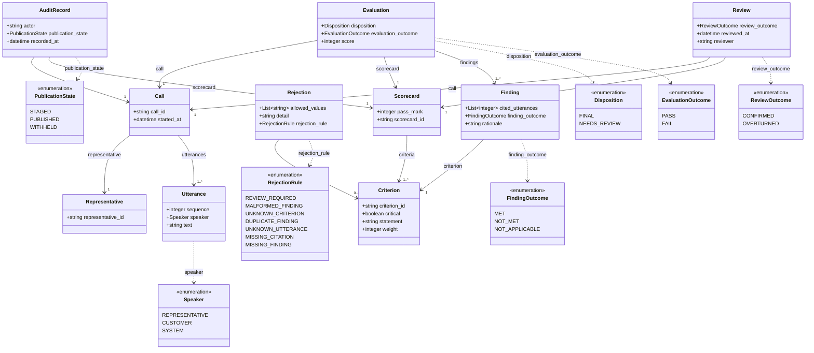

<!-- GENERATED by `onto gen` from ontology/domains/call-qa.yaml. Do not edit: change the source and regenerate. -->

# Call quality assurance glossary (L2)

Ubiquitous language of call quality assurance: Calls are evaluated against a Scorecard, one Finding per Criterion, and the Findings determine the score, the outcome and whether a person must review the Evaluation.

Source: `ontology/domains/call-qa.yaml`, version 0.1.0. Namespace: `https://bank.example/ontology/call-qa/`.

## Classes and their links

## Terms

| Term | Kind | Definition | Classification | Aliases | Never write |
| --- | --- | --- | --- | --- | --- |
| `AuditRecord` | class | The record of one change of the PublicationState of an Evaluation: which Evaluation, the state it entered, who caused it and when. It carries identifiers only, never the text of an Utterance, a rationale or a score. | internal |  | AuditLog, LogEntry |
| `Call` | class | One recorded conversation between a customer and a Representative, held as its Utterances in the order they were spoken. | PII |  |  |
| `Criterion` | class | One thing a Representative is expected to do on a Call, worded so that a Call either meets it or does not. | internal | scorecard question |  |
| `Evaluation` | class | The assessment of one Call against one Scorecard: exactly one Finding per Criterion, and the score, outcome and disposition that follow from them. | confidential |  | Assessment |
| `Finding` | class | The judgement of one Criterion for one Call: whether the Call met it, the Utterances cited in support and a short rationale. | confidential |  | Verdict |
| `Rejection` | class | The refusal to record a proposed Finding, to complete an Evaluation or to publish one, because it breaks a rule. It names the rule and says what would have been accepted, so that the proposer can correct itself. | internal |  |  |
| `Representative` | class | The bank employee who handles a Call. | PII | rep | Agent, Advisor |
| `Review` | class | A person's decision on an Evaluation whose disposition is NEEDS_REVIEW: whether the Evaluation stands. A Review is not a second Evaluation and it does not change the Findings or the score. | confidential |  | Approval, SignOff |
| `Scorecard` | class | The list of Criteria that Calls of one kind are evaluated against, together with the pass mark an Evaluation has to reach. | internal | QA form | Rubric, EvaluationForm |
| `Utterance` | class | One uninterrupted stretch of speech by one Speaker in a Call. Utterances are numbered from 1 in the order they were spoken. | PII | turn | Segment |
| `Disposition` | enum | What happens to an Evaluation once it is complete. | internal |  |  |
| `EvaluationOutcome` | enum | The possible outcomes of an Evaluation. | internal |  |  |
| `FindingOutcome` | enum | The possible outcomes of a Finding. | internal |  |  |
| `PublicationState` | enum | Where an Evaluation can stand on its way to the Representative. | internal |  |  |
| `RejectionRule` | enum | The rules a proposed Finding, an Evaluation or the publication of an Evaluation can break. | internal |  |  |
| `ReviewOutcome` | enum | What a Review can decide. | internal |  |  |
| `Speaker` | enum | Who can speak an Utterance. | internal |  |  |
| `actor` | slot | Who caused a change of PublicationState: the identifier of a reviewer, or the name of the system when no person was involved. | internal |  |  |
| `allowed_values` | slot | The values that would have been accepted, where they form a closed set. | internal |  |  |
| `call` | slot | The Call an Evaluation assesses. | internal |  |  |
| `call_id` | slot | The unique identifier of a Call. | internal |  |  |
| `cited_utterances` | slot | The sequence numbers of the Utterances a Finding relies on. In this context "evidence" is not used for them: in the workflow ontology Evidence means the result of a test run. | internal | citations | evidence |
| `criteria` | slot | The Criteria of a Scorecard. | internal |  |  |
| `criterion` | slot | The Criterion a Finding judges or a Rejection is about. | internal |  |  |
| `criterion_id` | slot | The identifier of a Criterion. | internal |  |  |
| `critical` | slot | Whether failing this Criterion fails the whole Evaluation, whatever the score. Absent means false. | internal |  |  |
| `detail` | slot | What was wrong, in words the proposer can act on. | internal |  |  |
| `disposition` | slot | Whether an Evaluation stands as it is or must be reviewed by a person first. | internal |  |  |
| `evaluation_outcome` | slot | Whether an Evaluation passed. | internal |  |  |
| `finding_outcome` | slot | Whether the Call met the Criterion. | internal |  |  |
| `findings` | slot | The Findings of an Evaluation, one per Criterion of its Scorecard. | internal |  |  |
| `pass_mark` | slot | The lowest score at which an Evaluation passes. | internal | pass mark |  |
| `publication_state` | slot | Where an Evaluation stands on its way to the Representative. | internal |  |  |
| `rationale` | slot | One or two sentences on why a Finding has its outcome. | confidential |  |  |
| `recorded_at` | slot | When an AuditRecord was made. | internal |  |  |
| `rejection_rule` | slot | The rule a Rejection reports as broken. | internal |  |  |
| `representative` | slot | The Representative who handled a Call. | PII |  |  |
| `representative_id` | slot | The bank's identifier for a Representative. | PII |  |  |
| `review_outcome` | slot | What a Review decided. | internal |  |  |
| `reviewed_at` | slot | When a Review was made. | internal |  |  |
| `reviewer` | slot | The bank's identifier for the person who made a Review. | PII |  |  |
| `score` | slot | The weight of the Criteria a Call met, as a whole-number percentage of the weight of the Criteria that applied to it. | confidential |  |  |
| `scorecard` | slot | The Scorecard an Evaluation applies. | internal |  |  |
| `scorecard_id` | slot | The unique identifier of a Scorecard, including its version. | internal |  |  |
| `sequence` | slot | The position of an Utterance in its Call, counted from 1. | internal |  |  |
| `speaker` | slot | Who spoke an Utterance. | internal |  |  |
| `started_at` | slot | When a Call began. | internal |  |  |
| `statement` | slot | The wording of a Criterion. | internal |  |  |
| `text` | slot | The words of an Utterance, as transcribed. | PII |  |  |
| `utterances` | slot | The Utterances of a Call, in the order they were spoken. | internal |  |  |
| `weight` | slot | How much a Criterion counts towards the score, relative to the other Criteria of its Scorecard. | internal |  |  |
| `Disposition.FINAL` | value | The Evaluation stands without review. | internal |  |  |
| `Disposition.NEEDS_REVIEW` | value | A person must review the Evaluation before it is used. | internal |  |  |
| `EvaluationOutcome.FAIL` | value | The score is below the pass mark, or a critical Criterion was failed. | internal |  |  |
| `EvaluationOutcome.PASS` | value | The score reached the pass mark and no critical Criterion was failed. | internal |  |  |
| `FindingOutcome.MET` | value | The Call met the Criterion. | internal |  |  |
| `FindingOutcome.NOT_APPLICABLE` | value | The Criterion did not apply to the Call. It counts neither for nor against the score. | internal |  |  |
| `FindingOutcome.NOT_MET` | value | The Criterion applied to the Call and the Call did not meet it. | internal |  |  |
| `PublicationState.PUBLISHED` | value | The Evaluation has been shown to the Representative. | internal |  |  |
| `PublicationState.STAGED` | value | The Evaluation is complete and has not been shown to the Representative. | internal |  |  |
| `PublicationState.WITHHELD` | value | A Review overturned the Evaluation. It is never shown to the Representative. | internal |  |  |
| `RejectionRule.DUPLICATE_FINDING` | value | A Finding for this Criterion has already been recorded. | internal |  |  |
| `RejectionRule.MALFORMED_FINDING` | value | The proposal is not a well-formed Finding. | internal |  |  |
| `RejectionRule.MISSING_CITATION` | value | The Finding is MET or NOT_MET and cites no Utterance. | internal |  |  |
| `RejectionRule.MISSING_FINDING` | value | A Criterion of the Scorecard has no Finding. | internal |  |  |
| `RejectionRule.REVIEW_REQUIRED` | value | The Evaluation has the disposition NEEDS_REVIEW and no Review has confirmed it, so it cannot be published. | internal |  |  |
| `RejectionRule.UNKNOWN_CRITERION` | value | The Finding names a Criterion that is not in the Scorecard. | internal |  |  |
| `RejectionRule.UNKNOWN_UTTERANCE` | value | The Finding cites an Utterance that is not in the Call. | internal |  |  |
| `ReviewOutcome.CONFIRMED` | value | The reviewer agrees that the Evaluation stands. It can be published. | internal |  |  |
| `ReviewOutcome.OVERTURNED` | value | The reviewer does not accept the Evaluation. It is withheld. | internal |  |  |
| `Speaker.CUSTOMER` | value | The person the bank is serving on the Call. | internal |  |  |
| `Speaker.REPRESENTATIVE` | value | The Representative handling the Call. | internal |  |  |
| `Speaker.SYSTEM` | value | A recorded announcement, such as the notice that the Call is recorded. | internal |  |  |

## Enums

### Disposition

What happens to an Evaluation once it is complete.

| Value | Definition |
| --- | --- |
| `FINAL` | The Evaluation stands without review. |
| `NEEDS_REVIEW` | A person must review the Evaluation before it is used. |

### EvaluationOutcome

The possible outcomes of an Evaluation.

| Value | Definition |
| --- | --- |
| `PASS` | The score reached the pass mark and no critical Criterion was failed. |
| `FAIL` | The score is below the pass mark, or a critical Criterion was failed. |

### FindingOutcome

The possible outcomes of a Finding.

| Value | Definition |
| --- | --- |
| `MET` | The Call met the Criterion. |
| `NOT_MET` | The Criterion applied to the Call and the Call did not meet it. |
| `NOT_APPLICABLE` | The Criterion did not apply to the Call. It counts neither for nor against the score. |

### PublicationState

Where an Evaluation can stand on its way to the Representative.

| Value | Definition |
| --- | --- |
| `STAGED` | The Evaluation is complete and has not been shown to the Representative. |
| `PUBLISHED` | The Evaluation has been shown to the Representative. |
| `WITHHELD` | A Review overturned the Evaluation. It is never shown to the Representative. |

### RejectionRule

The rules a proposed Finding, an Evaluation or the publication of an Evaluation can break.

| Value | Definition |
| --- | --- |
| `REVIEW_REQUIRED` | The Evaluation has the disposition NEEDS_REVIEW and no Review has confirmed it, so it cannot be published. |
| `MALFORMED_FINDING` | The proposal is not a well-formed Finding. |
| `UNKNOWN_CRITERION` | The Finding names a Criterion that is not in the Scorecard. |
| `DUPLICATE_FINDING` | A Finding for this Criterion has already been recorded. |
| `UNKNOWN_UTTERANCE` | The Finding cites an Utterance that is not in the Call. |
| `MISSING_CITATION` | The Finding is MET or NOT_MET and cites no Utterance. |
| `MISSING_FINDING` | A Criterion of the Scorecard has no Finding. |

### ReviewOutcome

What a Review can decide.

| Value | Definition |
| --- | --- |
| `CONFIRMED` | The reviewer agrees that the Evaluation stands. It can be published. |
| `OVERTURNED` | The reviewer does not accept the Evaluation. It is withheld. |

### Speaker

Who can speak an Utterance.

| Value | Definition |
| --- | --- |
| `REPRESENTATIVE` | The Representative handling the Call. |
| `CUSTOMER` | The person the bank is serving on the Call. |
| `SYSTEM` | A recorded announcement, such as the notice that the Call is recorded. |

## External mappings

| Term | Mapping | External concept |
| --- | --- | --- |
| `Call` | close | https://schema.org/Conversation |
| `Utterance` | close | https://schema.org/Message |
