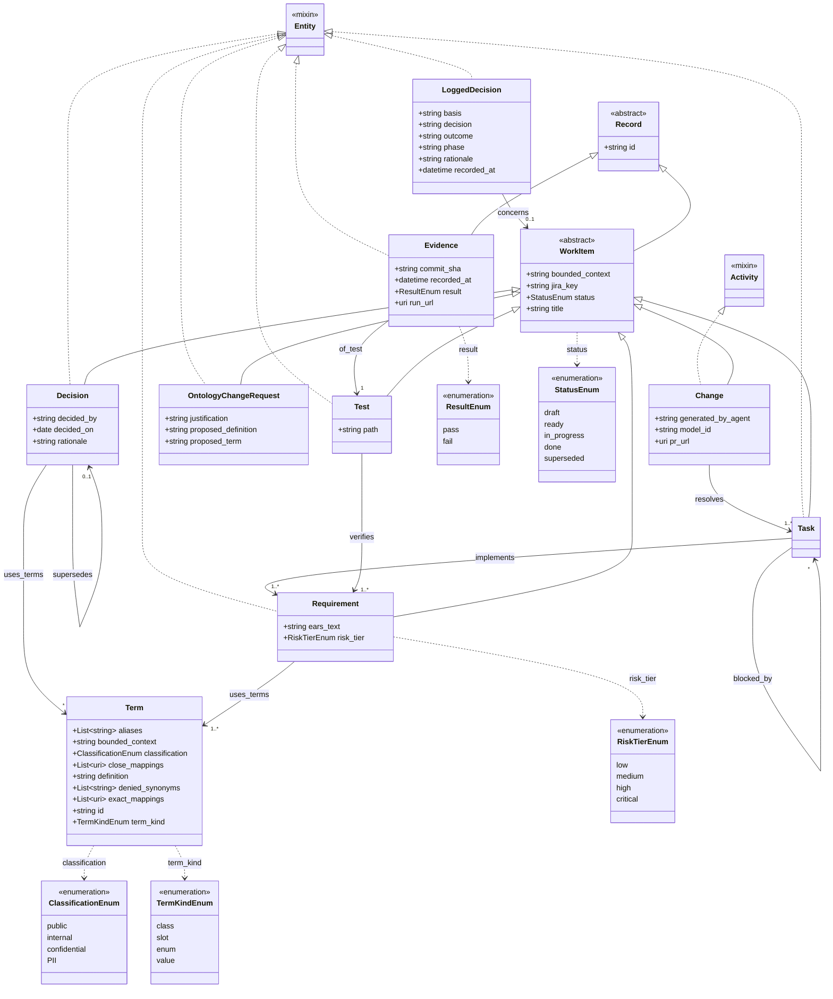

<!-- GENERATED by `onto gen` from ontology/workflow.yaml. Do not edit: change the source and regenerate. -->

# Workflow ontology (L1)

The typed spine of delivery work: requirements, tasks, decisions, changes, tests and evidence, and the links that make a change traceable from the requirement it serves to the test run that proves it.

Source: `ontology/workflow.yaml`, version 0.1.0. Namespace: `https://bank.example/ontology/workflow/`.

## Classes and their links

## Terms

| Term | Kind | Definition | Classification | Aliases | Never write |
| --- | --- | --- | --- | --- | --- |
| `Activity` | class | Something that happens over time and acts on entities (prov:Activity). | internal |  |  |
| `Change` | class | The act of changing the code to resolve Tasks. Usually one pull request. | internal |  |  |
| `Decision` | class | A choice that constrains later work, with its rationale. A Decision stays in force until another Decision supersedes it. | internal |  |  |
| `Entity` | class | Something that exists and can be described, used or produced (prov:Entity). | internal |  |  |
| `Evidence` | class | The recorded result of running one Test. Evidence is derived, never written by hand: `onto evidence collect` produces it from a test run. | internal |  |  |
| `LoggedDecision` | class | One line of an agent's decision log: what it decided while working, why and on what basis. Logged decisions are not files under work/. They are rows of .audit/<work item>.tsv, turned into provenance by `onto prov emit`. | internal |  |  |
| `OntologyChangeRequest` | class | A proposal to add, rename, redefine or retire a glossary Term. It is the only route by which a domain ontology changes, and a person approves it. | internal |  |  |
| `Record` | class | Anything stored as one file under work/ and identified by its id. | internal |  |  |
| `Requirement` | class | One thing the system must do, written as a single EARS sentence and bound to the glossary terms it is about. | internal |  |  |
| `Task` | class | A unit of work that implements one or more Requirements. | internal |  |  |
| `Term` | class | A term of a bounded context's glossary. Terms are not written by hand: the graph builder derives one from every class, slot, enum and permissible value of the context's domain ontology (ontology/domains/). | internal |  |  |
| `Test` | class | An automated test that verifies one or more Requirements. | internal |  |  |
| `WorkItem` | class | A Record that people and agents plan, do and track. | internal |  |  |
| `ClassificationEnum` | enum | Data classification, least to most sensitive. | internal |  |  |
| `ResultEnum` | enum |  | internal |  |  |
| `RiskTierEnum` | enum | How much review a change needs. | internal |  |  |
| `StatusEnum` | enum | The lifecycle shared by all work items. | internal |  |  |
| `TermKindEnum` | enum |  | internal |  |  |
| `aliases` | slot | Other spellings that resolve to a Term. | internal |  |  |
| `basis` | slot | What the decision rests on, such as a file, a command's output or a link. | internal |  |  |
| `blocked_by` | slot | Tasks that must be done before this one can start. | internal |  |  |
| `bounded_context` | slot | The bounded context the item belongs to. It selects the glossary its terms are checked against. | internal |  |  |
| `classification` | slot | How sensitive the data a Term names is. | internal |  |  |
| `close_mappings` | slot | Concepts in external vocabularies that are close to a Term. | internal |  |  |
| `commit_sha` | slot | The commit that was checked out when the Test ran. | internal |  |  |
| `concerns` | slot | The work item a logged decision was made for. | internal |  |  |
| `decided_by` | slot | Who made the Decision. | internal |  |  |
| `decided_on` | slot | The day the Decision was made. | internal |  |  |
| `decision` | slot | What was decided, in one sentence. | internal |  |  |
| `definition` | slot | What a Term means. | internal |  |  |
| `denied_synonyms` | slot | Names that must not be used for the concept a Term names. | internal |  |  |
| `ears_text` | slot | The requirement as one EARS sentence ("When <trigger>, the <system> shall <response>"). Glossary terms are written in backticks. | internal |  |  |
| `exact_mappings` | slot | Concepts in external vocabularies that mean the same as a Term. | internal |  |  |
| `generated_by_agent` | slot | The coding agent that produced the Change, if one did. | internal |  |  |
| `id` | slot | The identifier of a Record. It is also the name of its file. | internal |  |  |
| `implements` | slot | The Requirements a Task implements. | internal |  |  |
| `jira_key` | slot | The issue this item mirrors in the tracker, if any. | internal |  |  |
| `justification` | slot | Why the glossary must change, and which requirement needs it. | internal |  |  |
| `model_id` | slot | The model that agent ran on. | internal |  |  |
| `of_test` | slot | The Test whose run this Evidence records. | internal |  |  |
| `outcome` | slot | What came of the decision, once known. | internal |  |  |
| `path` | slot | The pytest node id of the Test, relative to the repository root. | internal |  |  |
| `phase` | slot | The stage of work a decision was logged in, such as plan, implement or verify. | internal |  |  |
| `pr_url` | slot | The pull request that carries the Change. | internal |  |  |
| `proposed_definition` | slot | The definition the term should have. | internal |  |  |
| `proposed_term` | slot | The term the request is about, spelled as it should appear in the glossary. | internal |  |  |
| `rationale` | slot | Why the Decision was made, and what was rejected. | internal |  |  |
| `recorded_at` | slot | When the record was made. | internal |  |  |
| `resolves` | slot | The Tasks a Change resolves. | internal |  |  |
| `result` | slot | Whether the Test passed. | internal |  |  |
| `risk_tier` | slot | How much review a change to this Requirement needs. | internal |  |  |
| `run_url` | slot | The CI run that produced the Evidence. | internal |  |  |
| `status` | slot | Where the item is in its lifecycle. | internal |  |  |
| `supersedes` | slot | The earlier Decision this one replaces. | internal |  |  |
| `term_kind` | slot | Whether a Term is a class, a slot, an enum or one value of an enum. | internal |  |  |
| `title` | slot | A one-line summary. | internal |  |  |
| `uses_terms` | slot | The glossary Terms this item is about. Each must exist in the item's bounded context. | internal |  |  |
| `verifies` | slot | The Requirements a Test verifies. | internal |  |  |
| `ClassificationEnum.PII` | value | Personal information about an identifiable person. | internal |  |  |
| `ClassificationEnum.confidential` | value |  | internal |  |  |
| `ClassificationEnum.internal` | value |  | internal |  |  |
| `ClassificationEnum.public` | value |  | internal |  |  |
| `ResultEnum.fail` | value |  | internal |  |  |
| `ResultEnum.pass` | value |  | internal |  |  |
| `RiskTierEnum.critical` | value |  | internal |  |  |
| `RiskTierEnum.high` | value |  | internal |  |  |
| `RiskTierEnum.low` | value |  | internal |  |  |
| `RiskTierEnum.medium` | value |  | internal |  |  |
| `StatusEnum.done` | value | Finished. For a Requirement, a claim the traceability gate checks. For a Decision, in force. | internal |  |  |
| `StatusEnum.draft` | value | Being written. Not yet agreed. | internal |  |  |
| `StatusEnum.in_progress` | value | Being worked on. | internal |  |  |
| `StatusEnum.ready` | value | Agreed and ready to be worked on. | internal |  |  |
| `StatusEnum.superseded` | value | Replaced by a later item and no longer in force. | internal |  |  |
| `TermKindEnum.class` | value |  | internal |  |  |
| `TermKindEnum.enum` | value |  | internal |  |  |
| `TermKindEnum.slot` | value |  | internal |  |  |
| `TermKindEnum.value` | value |  | internal |  |  |

## Enums

### ClassificationEnum

Data classification, least to most sensitive.

| Value | Definition |
| --- | --- |
| `public` |  |
| `internal` |  |
| `confidential` |  |
| `PII` | Personal information about an identifiable person. |

### ResultEnum

| Value | Definition |
| --- | --- |
| `pass` |  |
| `fail` |  |

### RiskTierEnum

How much review a change needs.

| Value | Definition |
| --- | --- |
| `low` |  |
| `medium` |  |
| `high` |  |
| `critical` |  |

### StatusEnum

The lifecycle shared by all work items.

| Value | Definition |
| --- | --- |
| `draft` | Being written. Not yet agreed. |
| `ready` | Agreed and ready to be worked on. |
| `in_progress` | Being worked on. |
| `done` | Finished. For a Requirement, a claim the traceability gate checks. For a Decision, in force. |
| `superseded` | Replaced by a later item and no longer in force. |

### TermKindEnum

| Value | Definition |
| --- | --- |
| `class` |  |
| `slot` |  |
| `enum` |  |
| `value` |  |

## External mappings

| Term | Mapping | External concept |
| --- | --- | --- |
| `Activity` | is | http://www.w3.org/ns/prov#Activity |
| `Entity` | is | http://www.w3.org/ns/prov#Entity |
| `aliases` | is | http://www.w3.org/2004/02/skos/core#altLabel |
| `close_mappings` | is | http://www.w3.org/2004/02/skos/core#closeMatch |
| `decision` | is | http://www.w3.org/ns/prov#value |
| `definition` | is | http://www.w3.org/2004/02/skos/core#definition |
| `exact_mappings` | is | http://www.w3.org/2004/02/skos/core#exactMatch |
| `recorded_at` | is | http://www.w3.org/ns/prov#generatedAtTime |
| `supersedes` | is | http://www.w3.org/ns/prov#wasRevisionOf |
